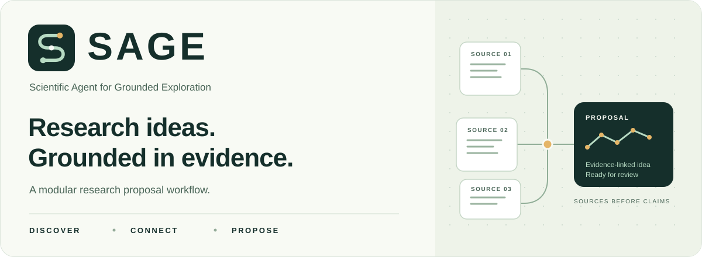

<p align="center">
  
</p>

<h1 align="center">SAGE · 基于证据探索的科研智能体</h1>

<p align="center">
  从研究问题出发，把文献发现、证据链、想法生成与实验方案连起来。<br>
  保留来源、失败和不确定性，让每一步都能回看。
</p>

<p align="center">
  <a href="#quickstart">快速开始</a> ·
  <a href="#capabilities">功能地图</a> ·
  <a href="#coi">与 CoI 的关系</a> ·
  <a href="docs/sage-runtime.md">运行指南</a> ·
  <a href="docs/roadmap.md">路线图</a>
</p>

---

**Scientific Agent for Grounded Exploration** 是一个逐步建设中的模块化科研提案工作流。核心代码与提示词位于 [sage/](sage/)，来自对 [CoI-Agent / Chain of Ideas](https://github.com/DAMO-NLP-SG/CoI-Agent) 的功能拆分与改造。离线与联网模式使用同一控制器，通过可替换的模型和文献提供方运行。

**当前状态**：提案链已实现并通过离线验证；live 适配器已实现、尚未真实联网实测；实验执行与论文写作仅有接口。生成的想法、方案和模型评分均需研究者复核，不能视作科学结果。

<a id="capabilities"></a>
## 从一个问题，到一份可追溯的提案

```text
研究问题 → 查询与检索 → 文献链与证据 → 候选想法 → 比较与筛查 → 实验方案
                                         ↑                      ↓
                                  有界的新颖性再生成       评审与补充证据修订
```

| 能力 | 现在可以做什么 | 代码 |
|---|---|---|
| **发现文献** | 查询生成、空结果改写、Semantic Scholar 检索、去重、日期过滤与重排 | [discovery](sage/discovery/) |
| **连接证据** | 前向被引 / 后向参考文献链、相关性判断、证据提取和阅读范围记录 | [literature](sage/literature/) |
| **形成想法** | 趋势与实体综合、未来方向、候选生成、定稿和有界再生成 | [ideation](sage/ideation/) |
| **比较与评审** | 检索范围内的新颖性筛查、六维两两比较、文献建议与方案评审 | [review](sage/review/) |
| **设计方案** | 实验方案、补充检索与证据支持的修订；保留修订历史 | [experiment_design](sage/experiment_design/) |
| **组织流程** | 类型契约、统一调用与时间预算、审计记录、结构检查与错误保留 | [orchestration](sage/orchestration/) |
| **后续扩展** | 执行与写作的 Protocol 接口，尚无 runner | [execution](sage/execution/) · [writing](sage/writing/) |

### 三个始终可见的边界

- **证据读到哪里，就写到哪里。** live 默认读取题录与摘要；授权全文可显式提供本地 article JSON，不自动下载 PDF 或启动 SciPDF/GROBID。
- **没有证据时，保留未知。** 没搜到相似论文不证明全球首次；空证据或无效回复不能变成“新颖”。
- **先把软件链跑通，再验证科研效果。** 离线 fixtures、契约检查和模型评分分别有用途，均不能替代真实实验与独立科学评价。

<a id="quickstart"></a>
## 5 分钟离线起步

Python **3.10+**，标准库即可运行。无需 API key、GPU、第三方依赖或网络调用。

```bash
git clone https://github.com/SiyuanChenToDo/Awesome-AutoResaerch.git
cd Awesome-AutoResaerch
git switch feat/ai-research-workbench

python -m sage doctor
python -m sage run --mode offline --topic "证据约束的研究想法生成" --output projects/sage-demo
python scripts/check.py
```

离线模式用固定的合成论文与假模型回答，经过同一控制器完成检索、追链、提取、构思、比较、方案与评审修订。它验证软件流程；更换 topic 不会让 fixtures 变成该领域的真实研究发现。

运行后在 `projects/sage-demo/` 查看：

| 文件 | 你能看到什么 |
|---|---|
| `result.json` | 候选、来源与证据链、筛查与比较、方案及修订、错误和契约检查 |
| `audit.jsonl` | 阶段、调用尝试、成功/失败与停止原因；非不可篡改日志 |
| `config.json` | 本次运行限制；不保存 API 密钥 |

`projects/` 默认不入 Git。`--output` 必须使用新的目录，以免覆盖研究记录。更多参数：`python -m sage run --help`。

<details>
<summary><strong>需要真实文献和模型？展开查看 live 入口</strong></summary>

先按[运行指南](docs/sage-runtime.md)配置 OpenAI/Azure 主模型、便宜模型、凭据和请求限制，再显式选择：

```bash
python -m sage run --mode live --allow-live --topic "你的研究问题" --output projects/sage-live
```

live 会把研究问题与检索/阅读内容发送给所选模型服务，并向 Semantic Scholar 发送检索请求。运行前确认数据可外传及模型费用；配置了凭据本身不会触发 live。

当前适配器有假客户端测试，但未做真实服务验证。可选 embedding 余弦重排未配置时，明确回退为词项匹配。`--articles` 按检索结果 ID/标题附加授权 article JSON，不是直接用本地 PDF 指定锚点的入口。

</details>

<a id="coi"></a>
## 与 CoI-Agent 的关系

SAGE 保留了 CoI 的核心研究提案方法，并拆为可以独立维护的功能模块。**它不是与原版逐行、逐行为相同的复刻。** 原始源码作为不可变来源保留，运行时不导入上游快照。

| 你关心的内容 | 当前情况 |
|---|---|
| **有原来的提示词吗？** | 19 个原始提示词函数全部有分模块迁移位置，并加入来源范围、结构化输出等修改。19 是迁移覆盖数；部分为扩展模板，并非全部进入默认主链。 |
| **有搜索代码吗？** | 有。包括 Semantic Scholar 查询、查询改写、引用关系、日期过滤、去重及可选 embedding 重排；未配置 embedding 时使用词项匹配。 |
| **有完整研究逻辑吗？** | 查询 → 文献链 → 提取 → 构思 → 判新/再生成 → 比较 → 方案/评审修订已实现并离线验证。 |
| **有哪些有意差异？** | 命名契约替代位置元组；循环与调用有上限；未知新颖性不再误判通过；默认全文下载/解析路径未迁移。 |
| **已经复现原论文效果吗？** | 尚未运行原始上游流程，也未实测 live 或复现科研指标。实验执行、自动论文写作和投稿均未实现。 |

提示词入口：[检索](sage/discovery/prompts.py) · [文献](sage/literature/prompts.py) · [构思](sage/ideation/prompts.py) · [方案](sage/experiment_design/prompts.py) · [评审](sage/review/prompts.py)

逐项方法、19 个函数和行为差异见 **[CoI → SAGE 迁移对照](docs/sage-migration.md)**。其中 `get_judge_experiment_all_prompt` 为可扩展的方案比较模板，默认主链实际比较候选想法。六维投票不宣称与上游行为或效果等价。

## 慢慢建设，先把每一步做实

| 阶段 | 状态与下一步 |
|---|---|
| **基础与提案链** | 已提供：模块化代码、提示词、离线控制器、项目模板和来源记录 |
| **真实服务验证** | 待做：在明确授权与预算下验证 live 接通、失败行为、来源质量和实际费用 |
| **更多方法接入** | Agent Laboratory 为后续研究重点，尚未导入、运行或集成 |
| **受限实验执行** | 待实现：批准计划身份、执行隔离、真实资源限额、失败保留和恢复 |
| **独立评价与写作** | 待实现：独立评价、可重建证据与结果驱动写作；以分阶段验收为准 |

[完整路线图](docs/roadmap.md)按验收条件推进，不承诺日期。karpathy/autoresearch 的计划任务按用户要求标为 `completed`，不再进入复现优先队列；其运行仍是 `not_run`，集成仍是 `not_integrated`。

## 导航与资料

| 我想…… | 从这里开始 |
|---|---|
| 跑通 SAGE、配置模型或查看产物 | [运行指南](docs/sage-runtime.md) |
| 了解模块、契约和科研人工门禁 | [模块地图](modules/README.md) · [架构](docs/architecture.md) · [研究工作流](docs/workflow.md) |
| 查工具、论文与评测 | [工具](catalog/tools.md) · [论文](catalog/papers.md) · [评测](catalog/benchmarks.md) · [精读路线](docs/reading-path.md) |
| 新建自己的研究项目 | [项目模板](templates/README.md) · [未执行的计划示例](examples/toy-regularization/README.md) |
| 核对来源和真实性边界 | [来源快照](sources/README.md) · [机器可读目录](catalog/records.json) · [抽查与纠错](catalog/verification.json) |
| 维护资料或贡献代码 | [贡献指南](CONTRIBUTING.md) · [资料维护](docs/catalog-maintenance.md) · [安全边界](SECURITY.md) |
| 使用或调整项目标志 | [SVG 资产与说明](assets/README.md) · [完整 logo](assets/sage-logo.svg) · [图标](assets/sage-icon.svg) |

<details>
<summary><strong>目录、项目工具与仓库结构</strong></summary>

```bash
python -m sage catalog search "hypothesis"
python -m sage catalog search --category benchmark
python -m sage project init my-first-study --title "我的第一个研究项目"
python -m sage project check-project projects/my-first-study
```

原入口 `python scripts/catalog.py ...` 和 `python scripts/research.py ...` 继续支持。项目初始化只创建 `draft` 模板，不调用模型、不运行实验；`--ready` 检查基本字段/路径，不代表科学有效或执行批准。目录收录不等于已核验或已集成。

```text
sage/                     自有运行包、分模块提示词、提供方与契约
assets/                   原创 SVG 标志与 README 横幅
modules/                  功能文档与旧 CoI 归档准备器
third_party/coi_agent/     不可变上游快照、许可与来源清单
catalog/ · sources/       可检索目录、独立核验记录与原始资料
docs/                     运行、迁移、工作流、架构与路线图
templates/ · examples/    项目模板与明确标注未执行的计划示例
scripts/ · tests/         兼容工具、统一离线检查与回归测试
projects/                 默认不入 Git 的本地研究产物
```

`python scripts/coi.py inspect` / `prepare --destination projects/coi-agent-runtime` 保留用于核验归档、生成带五个补丁的私有副本，不安装或运行上游依赖，也不是 SAGE 主运行路径。风险见[归档说明](third_party/coi_agent/README.md)。

</details>

## 来源与许可

SAGE 的方法与派生提示词来自 [DAMO-NLP-SG/CoI-Agent](https://github.com/DAMO-NLP-SG/CoI-Agent)，对应论文 [Chain of Ideas](https://arxiv.org/abs/2410.13185)。固定来源、原始文件哈希、Apache-2.0 许可和修改说明均保留，见 [CoI 归档](third_party/coi_agent/README.md)、[NOTICE](NOTICE.md)与[许可说明](LICENSE-NOTICE.md)。上游名称和引用不因 SAGE 品牌而改写，也不表示上游背书。

**本仓库尚未为全部原创部分指定统一开源许可证。** 第三方许可适用于对应部分；公开可见不自动授予全部内容的任意使用权。

仓库地址继续使用 `Awesome-AutoResaerch`，开发分支为 `feat/ai-research-workbench`。SAGE 是产品名称。当前以 CLI 和 GitHub README 为入口，后续逐步扩展。

---

<p align="center"><strong>让想法有来处，让未知被看见。</strong></p>
